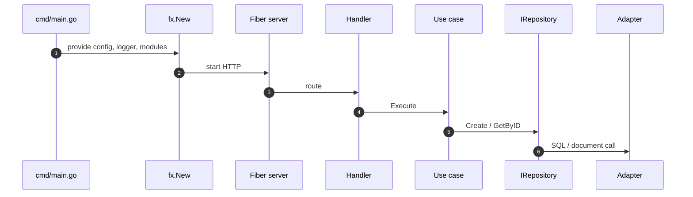

# Generated project layout

After `init` plus entity, use case, HTTP, and Postgres, a service looks like
this (names vary):

```text
blog-service/
├── cmd/
│   └── main.go                 # Fx app + scaffold markers
├── config/
│   ├── config.go               # Viper
│   └── config.yaml             # server, logging, database
├── go.mod
├── Makefile
├── README.md
└── internal/
    ├── domain/
    │   ├── post.go
    │   ├── post_repository.go
    │   └── post_test.go
    ├── usecase/
    │   ├── createpost_usecase.go
    │   ├── createpost_usecase_test.go
    │   └── module.go
    ├── entrypoints/
    │   ├── http/
    │   │   ├── handler/
    │   │   ├── routes/
    │   │   ├── middleware/
    │   │   └── server.go
    │   └── messaging/
    ├── drivenadapters/
    │   ├── database/
    │   ├── api/
    │   ├── messaging/
    │   └── cache/
    └── infrastructure/
        └── messaging/          # broker foundation modules
```

`init` creates the empty folders even before generate
([init.go directory list](https://github.com/bancolombia/scaffold-go/blob/master/internal/commands/init.go)).

## File ownership

| Created by | Typical paths |
|------------|----------------|
| `init` | `cmd/main.go`, `config/*`, `go.mod`, `Makefile` |
| `generate entity` | `internal/domain/{name}.go` |
| `generate usecase` | `internal/usecase/{name}_usecase.go` |
| `generate ep http` | `internal/entrypoints/http/**` |
| `generate ep consumer` | `entrypoints/messaging`, `infrastructure/messaging` |
| `generate da database` | `drivenadapters/database`, YAML append |
| `generate da api` | `drivenadapters/api` |
| `generate da publisher` | `drivenadapters/messaging`, infrastructure |
| `generate da cache` | `drivenadapters/cache` |

## Runtime flow (HTTP)



<!-- Sources: project/main.go.tmpl, internal/generator/handler.go, internal/generator/usecase.go -->

## What you own vs what the CLI owns

The CLI will overwrite some component files on re-run. Treat generated
`TODO` stubs as starting points. Preserve `scaffold-go:*` comments in
`main.go`. Prefer adding new files for extra routes rather than fighting
skipped `routes.go` merges (there is a TODO to merge routes instead of
skipping).

## Related pages

| Page | Relationship |
|------|-------------|
| [Init](../guides/init.md) | Empty tree |
| [Architecture overview](./overview.md) | Layer rules |
| [Templates](../reference/templates.md) | Which `.tmpl` maps to which file |
