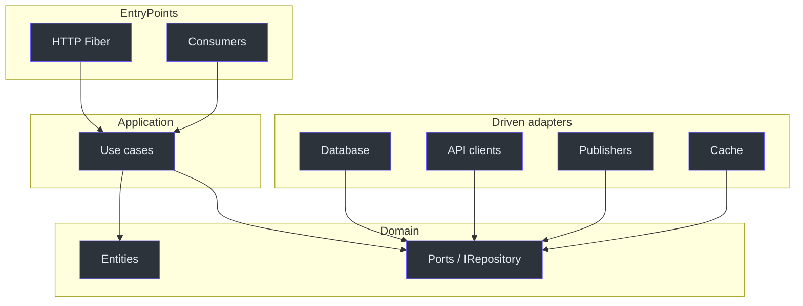

# Architecture overview

scaffold-go is two architectures in one repository:

1. **The CLI** — Cobra commands → validators → generators → templates →
   filesystem
2. **The generated service** — domain / entry-points / driven adapters + Fx

The CLI's root help states the dependency rule: dependencies point inward
toward the domain
([internal/commands/root.go](https://github.com/bancolombia/scaffold-go/blob/master/internal/commands/root.go)).

## Generated service layers

| Layer | Folder | Allowed to import | Must not import |
|-------|--------|-------------------|-----------------|
| Domain | `internal/domain` | Go stdlib, domain types | Fiber, SQL, brokers |
| Use cases | `internal/usecase` | domain, Zap | HTTP, drivers |
| Entry-points | `internal/entrypoints` | usecase, Fiber / broker SDKs | database adapters |
| Driven adapters | `internal/drivenadapters` | domain ports, drivers | entry-points |
| Infrastructure | `internal/infrastructure` | broker clients | domain details |
| Config / cmd | `config`, `cmd` | Fx, Viper, modules | business rules |

<!-- Sources: internal/commands/root.go, internal/commands/generate.go -->

## Comparison

| Concern | Hexagonal / clean | What scaffold-go emits |
|---------|-------------------|------------------------|
| Domain model | Entities | `generate entity` |
| Application API | Use cases | `generate usecase` |
| Driving ports | Handlers, consumers | `generate ep` |
| Driven ports | Repository and gateway interfaces | `I{Name}Repository`, `generate interface` |
| Driven adapters | SQL, HTTP, MQ | `generate da` |

Python analogue: a Django app often mixes models, views, and ORM in one
package. Here the ORM (or mongo driver) is generated **outside** `domain`,
behind `IUserRepository`.

## CLI package map

| Package | Role |
|---------|------|
| [cmd](https://github.com/bancolombia/scaffold-go/blob/master/cmd/main.go) | `main`, error exit codes |
| [internal/commands](https://github.com/bancolombia/scaffold-go/tree/master/internal/commands) | Cobra surface |
| [internal/validator](https://github.com/bancolombia/scaffold-go/tree/master/internal/validator) | Names, go.mod, fields |
| [internal/generator](https://github.com/bancolombia/scaffold-go/tree/master/internal/generator) | Component-specific generation |
| [internal/template](https://github.com/bancolombia/scaffold-go/tree/master/internal/template) | Embed + execute templates |
| [internal/filesystem](https://github.com/bancolombia/scaffold-go/tree/master/internal/filesystem) | Write + `gofmt` |
| [internal/manager](https://github.com/bancolombia/scaffold-go/tree/master/internal/manager) | Patch `main.go` and Fx modules |
| [internal/parser](https://github.com/bancolombia/scaffold-go/tree/master/internal/parser) | Module path from `go.mod` |
| [internal/domain](https://github.com/bancolombia/scaffold-go/tree/master/internal/domain) | CLI error types (not generated domain) |

## Related pages

| Page | Relationship |
|------|-------------|
| [Generated project](./generated-project.md) | Folder tree after generate |
| [CLI internals](./cli-internals.md) | Command → generator pipeline |
| [Feature workflow](../guides/workflow.md) | How users apply the layers |
