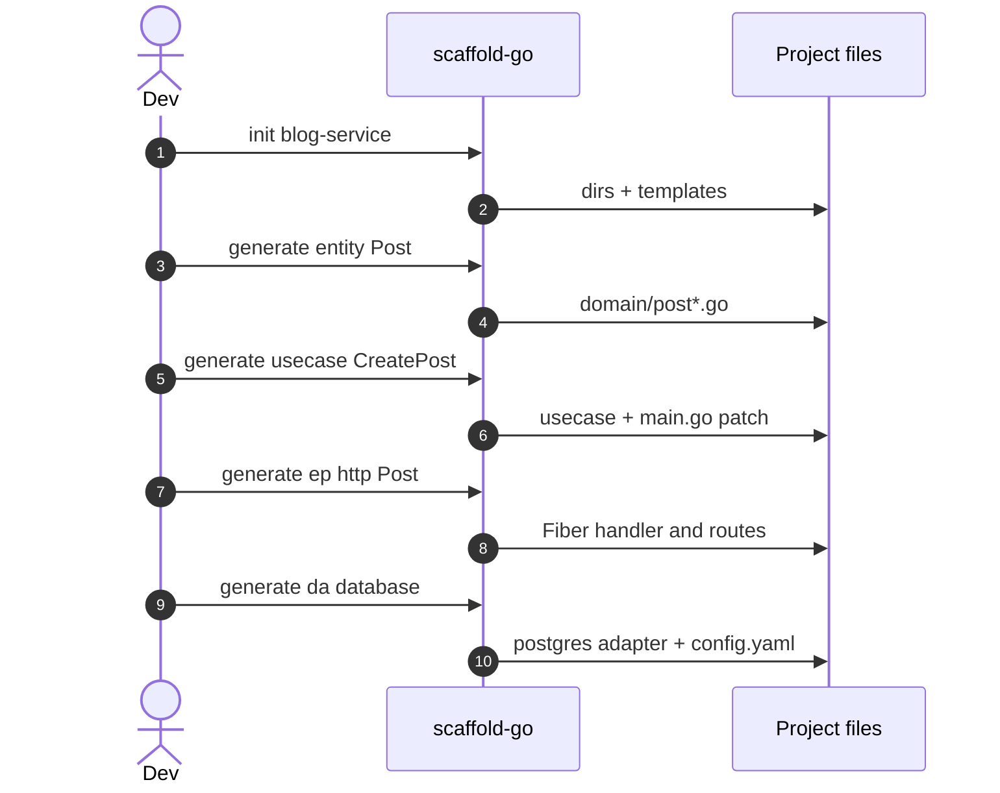

# First project

This walkthrough creates a tiny **blog-service** with a `Post` entity, a
`CreatePost` use case, a Fiber HTTP handler, and a PostgreSQL repository.
Run every `generate` command **from the project root** (the directory that
contains `go.mod`). The CLI looks upward for `go.mod` via
`ValidateProjectInitialized`
([internal/validator/validator.go](https://github.com/bancolombia/scaffold-go/blob/master/internal/validator/validator.go)).

## 1. Initialize

```bash
scaffold-go init blog-service --module github.com/user/blog-service
cd blog-service
```

What you get (see [Init](../guides/init.md)):

```text
blog-service/
├── cmd/main.go
├── config/config.go
├── config/config.yaml
├── go.mod
├── Makefile
├── README.md
└── internal/
    ├── domain/
    ├── entrypoints/http|messaging/
    ├── drivenadapters/database|api|messaging|cache/
    └── infrastructure/messaging/
```

## 2. Domain entity

```bash
scaffold-go generate entity Post --fields Title:string,Content:string,AuthorID:string
```

Files:

- `internal/domain/post.go` — struct, constructor, `Validate`
- `internal/domain/post_repository.go` — `IPostRepository` CRUD interface
- `internal/domain/post_test.go`

Names and field names must be PascalCase. See [Naming](./naming.md).

## 3. Use case

```bash
scaffold-go generate usecase CreatePost --dependencies postRepo:IPostRepository
```

:::tip Repository type
Entity generation names the interface `I{Entity}Repository` (for example
`IPostRepository`). Pass that exact type to `--dependencies` so the use case
imports `domain.IPostRepository`.
:::

Files:

- `internal/usecase/createpost_usecase.go`
- `internal/usecase/createpost_usecase_test.go`
- `internal/usecase/module.go` — `fx.Provide(NewCreatePostUseCase)`

The CLI also patches `cmd/main.go` with `usecase.Module`
([generate_usecase.go](https://github.com/bancolombia/scaffold-go/blob/master/internal/commands/generate_usecase.go)).

Open the use case and replace the `TODO` in `Execute` with real logic.

## 4. HTTP entry-point

```bash
scaffold-go generate ep http Post \
  --usecases createPost:CreatePostUseCase \
  --routes POST:/posts:CreatePost,GET:/posts/:id:GetPost
```

If you pass `PostHandler`, the CLI strips the `Handler` suffix.

Typical files:

- `internal/entrypoints/http/handler/post_handler.go`
- `internal/entrypoints/http/handler/health_handler.go` (first HTTP generate only)
- `internal/entrypoints/http/routes/post_router.go`
- `internal/entrypoints/http/server.go` (first HTTP generate)
- CORS middleware when `--enable-cors` is true (default)

## 5. PostgreSQL driven adapter

The database generator **requires** the entity and repository files to exist.

```bash
scaffold-go generate da database \
  --type postgres \
  --entity Post \
  --fields Title:string,Content:string,AuthorID:string
```

This writes adapter + `post_repository.go` under
`internal/drivenadapters/database/` and appends a `database:` block to
`config/config.yaml` when missing.

## 6. Tidy, fill TODOs, run

```bash
go mod tidy
go build -o blog-service cmd/main.go
```

:::warning
Generated handlers return `{"status":"ok"}` until you call the use case.
Generated repositories contain SQL/document stubs you must align with your
schema. Some Fx modules may still need a provider for `IPostRepository` →
Postgres implementation — check `internal/drivenadapters/database/module.go`
and `cmd/main.go` after generation.
:::



<!-- Sources: internal/commands/init.go, generate_entity.go, generate_usecase.go, generate_ep.go, generate_da.go -->

## Related pages

| Page | Relationship |
|------|-------------|
| [Feature workflow](../guides/workflow.md) | Same order with more options |
| [Entities](../guides/entities.md) | Field types and repository contract |
| [HTTP entry-points](../guides/http-entry-points.md) | CORS, rate limiter, routes |
| [Troubleshooting](../reference/troubleshooting.md) | `go.mod` not found, invalid names |
