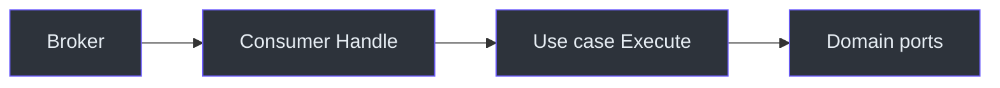

# Message consumers

`generate ep consumer` creates a **driving** messaging adapter: a process
that receives messages and calls use cases. Kafka is a placeholder and
returns a friendly error.

Source:
[NewGenerateEpConsumerCommand](https://github.com/bancolombia/scaffold-go/blob/master/internal/commands/generate_ep.go),
[internal/generator/consumer.go](https://github.com/bancolombia/scaffold-go/blob/master/internal/generator/consumer.go).

## Command

```bash
scaffold-go generate ep consumer [name] \
  --broker rabbitmq|ibmmq|kafka \
  --pattern <pattern> \
  [--usecases name:Type[:Package]] \
  [--queue <queue|topic|event>]
```

| Flag | Short | Required | Notes |
|------|-------|----------|-------|
| `--broker` | `-b` | yes | `rabbitmq`, `ibmmq`, `kafka` |
| `--pattern` | `-p` | yes | Depends on broker |
| `--usecases` | `-u` | no | `name:Type[:Package]` |
| `--queue` | `-q` | no | Defaults to lowercased component name |

## Brokers and patterns

| Broker | Patterns | Library |
|--------|----------|---------|
| `rabbitmq` | `event`, `command`, `query`, `notification` | [reactive-commons-go](https://github.com/bancolombia/reactive-commons-go) |
| `ibmmq` | `listener`, `requestreply` | [commons-mq-go](https://github.com/bancolombia/commons-mq-go) (CGO + IBM MQ C client) |
| `kafka` | — | Not implemented |

```bash
scaffold-go generate ep consumer OrderEventConsumer \
  --broker rabbitmq --pattern event \
  --usecases processOrder:ProcessOrderUseCase \
  --queue order.created

scaffold-go gen ep consumer InvoiceListener \
  --broker ibmmq --pattern listener \
  --queue DEV.QUEUE.INVOICES
```

## What is generated

- Consumer file under `internal/entrypoints/messaging/...` tailored to
  broker/pattern (templates in
  [templates/ep/consumer](https://github.com/bancolombia/scaffold-go/tree/master/internal/template/templates/ep/consumer))
- Per-component Fx module
- On **first** use of a broker: shared infrastructure module under
  `internal/infrastructure/messaging/{broker}/`
- Patch of `cmd/main.go` between `scaffold-go:imports` / `scaffold-go:modules`
  markers (`wireConsumerIntoMain`)

The CLI prints `Run go mod tidy to fetch broker dependencies.`

## After generation

1. `go mod tidy`.
2. Fill the `Handle` (or equivalent) method: unmarshal payload, call the
   use case, ack/nack according to the broker library.
3. Set broker connection settings (environment / config) required by
   reactive-commons-go or commons-mq-go.
4. IBM MQ: install the IBM MQ C client; builds need CGO.



<!-- Sources: internal/commands/generate_ep.go, internal/generator/consumer.go -->

## Related pages

| Page | Relationship |
|------|-------------|
| [Publishers](./publishers.md) | Outbound messaging (driven adapter) |
| [Dependency injection](./dependency-injection.md) | Auto-wiring of foundation modules |
| [Troubleshooting](../reference/troubleshooting.md) | Kafka error, CGO, missing markers |
