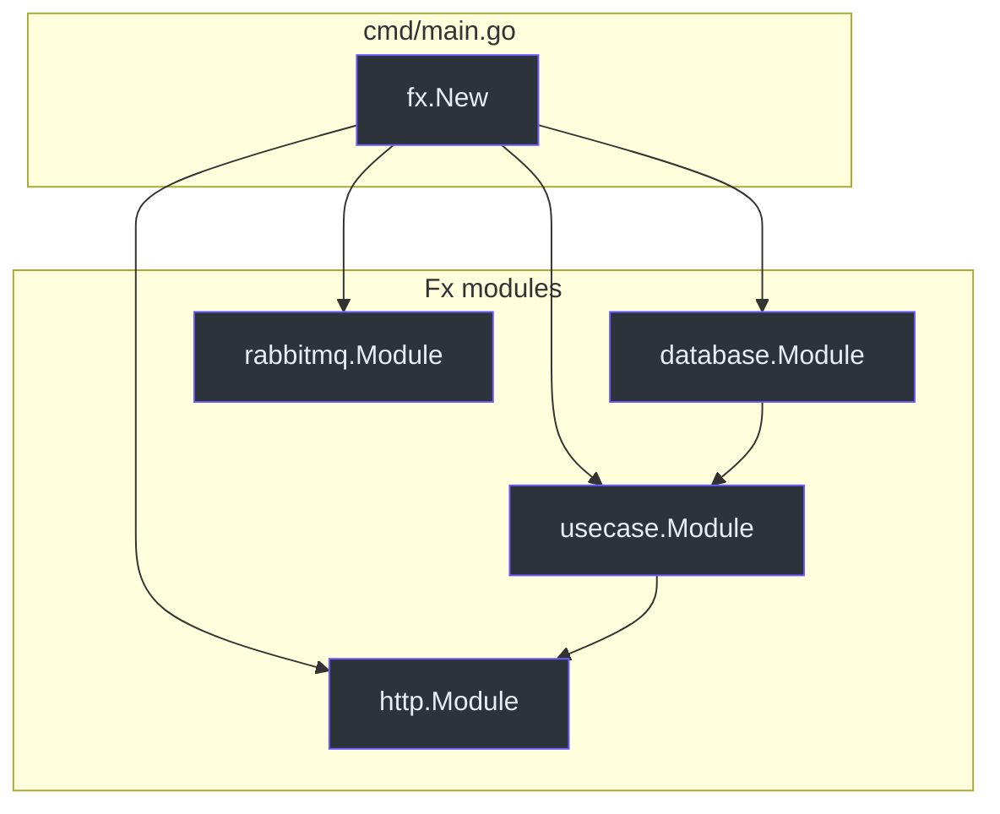

# Dependency injection

Generated apps use [uber-go/fx](https://github.com/uber-go/fx). Constructors
are registered as `fx.Provide`; groups of providers are `fx.Module` values.

## Markers in main.go

[project/main.go.tmpl](https://github.com/bancolombia/scaffold-go/blob/master/internal/template/templates/project/main.go.tmpl)
emits:

```go
// scaffold-go:imports:begin
"{{.ModulePath}}/config"
// scaffold-go:imports:end

app := fx.New(
    fx.Invoke(run),
    fx.Provide(
        config.NewConfig,
        zap.NewProduction,
    ),
    // scaffold-go:modules:begin
    // scaffold-go:modules:end
)
```

[MainFileManager](https://github.com/bancolombia/scaffold-go/blob/master/internal/manager/main_file.go)
inserts imports and module identifiers **between** those comments.

| Generator | Import (typical) | Module |
|-----------|------------------|--------|
| usecase | `.../internal/usecase` | `usecase.Module` |
| ep http | `.../internal/entrypoints/http` | `http.Module` |
| ep consumer | broker foundation + consumers pkg | `{alias}.Module`, consumers module |
| da publisher | broker foundation + publishers pkg | `{alias}.Module`, `publishers.Module` |

If markers are deleted, auto-wiring cannot find an insertion point. You will
see a warning and must edit `main.go` yourself.

## Per-package modules

| Package | File | Providers |
|---------|------|-----------|
| usecase | `internal/usecase/module.go` | `New{Name}UseCase` (appended) |
| HTTP handler | `internal/entrypoints/http/handler/module.go` | First handler only unless you edit |
| database | `internal/drivenadapters/database/module.go` | First DB generate |
| api / cache | `module.go` in that folder | Regenerated with the component |



<!-- Sources: internal/template/templates/project/main.go.tmpl, internal/manager/main_file.go, internal/commands/generate_usecase.go -->

## Missing dependencies

Fx resolves a graph. Typical gap after scaffolding:

- `CreateUserUseCase` needs `domain.IUserRepository`
- No constructor returns `IUserRepository` until the database module is
  registered **and** the constructor return type matches the interface

Fix: `fx.Provide` the repository with an interface annotation, or change the
adapter constructor to return `domain.IUserRepository`.

## Related pages

| Page | Relationship |
|------|-------------|
| [Use cases](./use-cases.md) | Writes `usecase.Module` |
| [HTTP entry-points](./http-entry-points.md) | `http.Module` limitations |
| [Consumers](./consumers.md) | Broker foundation modules |
