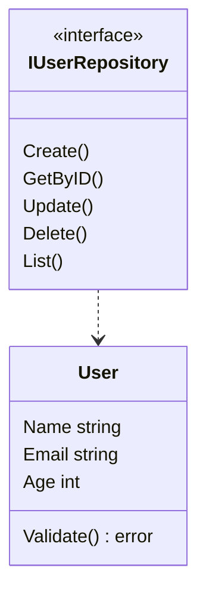

# Generate entities

An entity is the domain model plus a persistence **port**. Nothing in these
files imports databases or HTTP.

Source:
[internal/commands/generate_entity.go](https://github.com/bancolombia/scaffold-go/blob/master/internal/commands/generate_entity.go),
[internal/generator/entity.go](https://github.com/bancolombia/scaffold-go/blob/master/internal/generator/entity.go).

## Command

```bash
scaffold-go generate entity [name] --fields Name:type,Other:type
```

| Flag | Short | Required | Format |
|------|-------|----------|--------|
| `--fields` | `-f` | yes | `Name:type` comma-separated |

```bash
scaffold-go generate entity User --fields Name:string,Email:string,Age:int
scaffold-go gen entity Product -f Name:string,Price:float64,Stock:int
scaffold-go generate entity Order --fields UserID:string,Total:float64,CreatedAt:time.Time
```

`--fields` is marked required. Names must be PascalCase.

## Files written

For name `User`:

| File | Content |
|------|---------|
| `internal/domain/user.go` | Struct, `NewUser`, `Validate` |
| `internal/domain/user_repository.go` | `IUserRepository` |
| `internal/domain/user_test.go` | Tests from `entity_test.go.tmpl` |

The repository interface is always named `I` + entity + `Repository`.

## Generated shape (illustrative)

From
[entity.go.tmpl](https://github.com/bancolombia/scaffold-go/blob/master/internal/template/templates/domain/entity/entity.go.tmpl)
and
[repository.go.tmpl](https://github.com/bancolombia/scaffold-go/blob/master/internal/template/templates/domain/entity/repository.go.tmpl):

```go
package domain

type User struct {
    Name  string
    Email string
    Age   int
}

func NewUser(name string, email string, age int) (*User, error) {
    entity := &User{Name: name, Email: email, Age: age}
    if err := entity.Validate(); err != nil {
        return nil, err
    }
    return entity, nil
}

func (e *User) Validate() error {
    return nil
}
```

```go
package domain

import "context"

type IUserRepository interface {
    Create(ctx context.Context, entity *User) error
    GetByID(ctx context.Context, id string) (*User, error)
    Update(ctx context.Context, entity *User) error
    Delete(ctx context.Context, id string) error
    List(ctx context.Context, limit, offset int) ([]*User, error)
}
```

`Validate()` only emits required-field checks when template `Field.Required`
is set; the CLI field parser currently passes name and type only, so you
usually add validation yourself.

If any field type contains `time.Time`, the entity file imports `"time"`.

## What to do next

1. Add an `ID` field if your model needs one (not added automatically).
2. Implement `Validate` for invariants (email format, non-negative age).
3. Generate a [use case](./use-cases.md) that depends on `IUserRepository`.
4. Generate a [database adapter](./database-adapters.md) with the **same**
   entity name and fields.



<!-- Sources: internal/template/templates/domain/entity/entity.go.tmpl, repository.go.tmpl -->

## Related pages

| Page | Relationship |
|------|-------------|
| [Naming](../getting-started/naming.md) | Field and entity name rules |
| [Use cases](./use-cases.md) | `--dependencies userRepo:IUserRepository` |
| [Database adapters](./database-adapters.md) | Implements `IUserRepository` |
