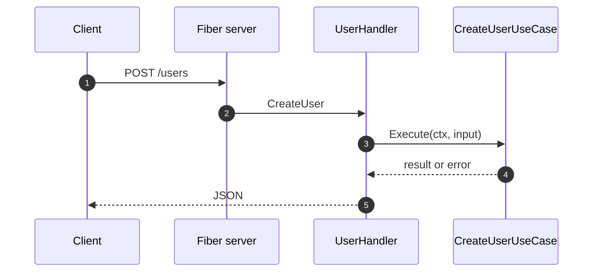

# HTTP entry-points

`generate ep http` creates the **driving** HTTP adapter: Fiber handlers that
call use cases. It does not start a process by itself; `cmd/main.go` must
include the HTTP Fx module (the generator tries to add `http.Module`).

Source:
[NewGenerateEpHttpCommand](https://github.com/bancolombia/scaffold-go/blob/master/internal/commands/generate_ep.go),
[HandlerGenerator](https://github.com/bancolombia/scaffold-go/blob/master/internal/generator/handler.go).

## Command

```bash
scaffold-go generate ep http [name] [flags]
```

| Flag | Short | Default | Format |
|------|-------|---------|--------|
| `--usecases` | `-u` | empty | `name:Type` |
| `--routes` | `-r` | empty | `METHOD:path:Handler` |
| `--enable-cors` | | `true` | CORS middleware file |
| `--enable-rate-limiter` | | `true` | Rate limiter on the server |
| `--enable-error-handler` | | `true` | Custom Fiber error handler |

If `name` ends with `Handler`, that suffix is removed (`UserHandler` → `User`).

```bash
scaffold-go generate ep http User \
  --usecases createUser:CreateUserUseCase,getUser:GetUserUseCase \
  --routes POST:/users:CreateUser,GET:/users/:id:GetUser

scaffold-go gen ep http HealthHandler \
  --routes GET:/health:CheckHealth \
  --enable-cors=false --enable-rate-limiter=false --enable-error-handler=false
```

HTTP methods are accepted case-insensitively in tests. Paths can include
Fiber params (`:id`).

## Files (first vs later)

| Path | First HTTP generate | Later handlers |
|------|---------------------|----------------|
| `internal/entrypoints/http/handler/{name}_handler.go` | written | written |
| `handler/health_handler.go` | written | skipped if exists |
| `handler/module.go` | written | skipped if exists (see note) |
| `routes/routes.go` | written | skipped |
| `routes/health_router.go` | written | skipped |
| `routes/{name}_router.go` | written | written |
| `middleware/cors.go` | if CORS enabled | skipped if exists |
| `server.go` | Fiber app | skipped if exists |

:::note
If `handler/module.go` already exists, the generator currently **does not**
append a new `New{Name}Handler` provider (there is a TODO in
`HandlerGenerator.Generate`). Add the constructor to the Fx module by hand
for the second handler.
:::

## Handler stub

From
[http_handler.go.tmpl](https://github.com/bancolombia/scaffold-go/blob/master/internal/template/templates/ep/http/handler/http_handler.go.tmpl):

```go
func (h *UserHandler) CreateUser(c *fiber.Ctx) error {
    h.logger.Info("handling request",
        zap.String("method", "POST"),
        zap.String("path", "/users"),
        zap.String("ip", c.IP()))
    // TODO: Add request validation logic
    // TODO: Implement handler logic
    return c.JSON(fiber.Map{"status": "ok"})
}
```

**Your job:** bind JSON, call `h.createUser.Execute`, map errors to HTTP
status codes, return the real body.

## Middleware defaults

| Flag | Behavior |
|------|----------|
| CORS on | Writes CORS middleware with configurable origins/methods/headers |
| Rate limiter on | IP-based limiter on the Fiber app |
| Error handler on | Custom Fiber error handler |

Turn them off with `--enable-cors=false` (and the other two flags) for
internal services.



<!-- Sources: internal/generator/handler.go, ep/http/handler/http_handler.go.tmpl -->

## Related pages

| Page | Relationship |
|------|-------------|
| [Use cases](./use-cases.md) | Types passed to `--usecases` |
| [Consumers](./consumers.md) | Non-HTTP entry-points |
| [Configuration](./configuration.md) | `server.host` / `server.port` |
