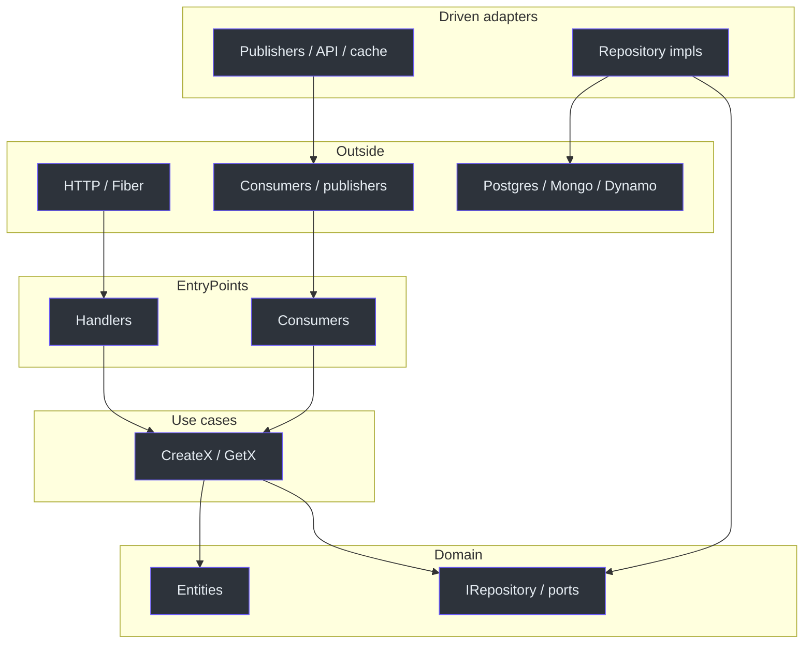

# Feature workflow

`generate` documents the order in its long help
([internal/commands/generate.go](https://github.com/bancolombia/scaffold-go/blob/master/internal/commands/generate.go)):

1. **entity** — model + repository port
2. **usecase** — application logic that depends on ports
3. **ep** — HTTP or message consumer that calls the use case
4. **da** — database, API, publisher, or cache that implements ports

Skipping entity before `da database` fails validation: the adapter generator
checks that `internal/domain/{entity}.go` and `{entity}_repository.go` exist
([database_adapter.go](https://github.com/bancolombia/scaffold-go/blob/master/internal/generator/database_adapter.go)).

## Dependency rule

<!-- Sources: internal/commands/root.go, internal/commands/generate.go -->

Dependencies point **inward**. Domain templates do not import Fiber, SQL
drivers, or broker SDKs
([entity property tests](https://github.com/bancolombia/scaffold-go/blob/master/internal/generator/entity_properties_test.go)).

## Checklist for a new capability

1. `cd` into the initialized module.
2. Generate the entity with the fields you need for persistence **and** HTTP.
3. Generate one use case per action (`CreateX`, `GetX`, `ListX`, …).
4. Choose an entry-point:
   - Synchronous API → [HTTP](./http-entry-points.md)
   - Queue/topic → [consumer](./consumers.md)
5. Implement outbound I/O:
   - Persistence → [database](./database-adapters.md)
   - Other HTTP API → [API client](./api-clients.md)
   - Emit messages → [publisher](./publishers.md)
   - Cache → [cache](./cache.md)
6. `go mod tidy`, fill TODOs, wire any missing Fx providers.
7. Run with `-v` on the CLI if generation skipped files or failed validation.

## Persistent generate flags

Declared on `generate` but **not read** by current generators (they always
use `projectDir := "."`):

| Flag | Declared meaning |
|------|------------------|
| `-o`, `--output-path` | Output directory relative to project root |
| `--force` | Overwrite existing files |

Work from the module root. Re-running some generators is idempotent for
shared files (health handler, CORS, database adapter connection file) and
overwrites component-specific files without `--force`.

## Related pages

| Page | Relationship |
|------|-------------|
| [First project](../getting-started/first-project.md) | Concrete commands |
| [Architecture overview](../architecture/overview.md) | Layer responsibilities |
| [Dependency injection](./dependency-injection.md) | How `cmd/main.go` is patched |
