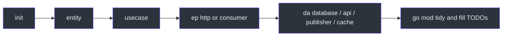

# scaffold-go

**scaffold-go** is a Cobra CLI that creates Go microservice projects and then
adds components in a fixed order: **entity → use case → entry-point (`ep`) →
driven adapter (`da`)**. Generated code follows clean architecture: the domain
has no infrastructure imports; HTTP, messaging, databases, and caches live at
the edges; [uber-go/fx](https://github.com/uber-go/fx) wires constructors.

This site is the user and contributor handbook. Markdown lives in the
repository `docs/` folder and is published with Docusaurus on GitHub Pages.

## Why it exists

Hand-rolling the same `cmd/main.go`, Viper config, repository interface, and
Fx module for every service wastes time and drifts from the house style.
scaffold-go encodes that layout in templates and generators so a new service
starts with:

- A Go module, Makefile, and `config/` package
- Empty layer folders (`domain`, `entrypoints`, `drivenadapters`)
- Marker comments in `cmd/main.go` so later `generate` commands can patch
  imports and Fx modules automatically

Source: [cmd/main.go](https://github.com/bancolombia/scaffold-go/blob/master/cmd/main.go),
[internal/commands/root.go](https://github.com/bancolombia/scaffold-go/blob/master/internal/commands/root.go),
[internal/commands/init.go](https://github.com/bancolombia/scaffold-go/blob/master/internal/commands/init.go).

## What you generate

| Layer | Command | Kind | Typical output |
|-------|---------|------|----------------|
| Project | `scaffold-go init` | — | Module, `cmd/main.go`, `config/`, layer dirs |
| Domain | `generate entity` | — | Struct, `I{Name}Repository`, tests |
| Domain | `generate interface` | — | `I{Name}` port on an existing entity |
| Domain | `generate usecase` | — | Use case + `internal/usecase/module.go` |
| Entry-point | `generate ep http` | Fiber handler | Handler, routes, server, CORS |
| Entry-point | `generate ep consumer` | rabbitmq / ibmmq | Consumer + broker foundation module |
| Driven adapter | `generate da database` | postgres / mongodb / dynamodb | Adapter + repository impl |
| Driven adapter | `generate da api` | HTTP client | Client stub + Fx module |
| Driven adapter | `generate da publisher` | rabbitmq / ibmmq | Publisher + broker foundation |
| Driven adapter | `generate da cache` | Redis/in-memory stub | Cache adapter |

Aliases: `generate`, `gen`, and `g` are the same command.

## Recommended path

<!-- Sources: internal/commands/generate.go, internal/commands/init.go -->

1. [Install the CLI](./getting-started/installation.md)
2. [Create a project](./getting-started/first-project.md)
3. Follow the [feature workflow](./guides/workflow.md)

:::note
Generated files include `TODO` comments. The CLI does **not** produce a
production-ready service by itself. You implement business logic, connect real
clients (DB, Redis, brokers), and run `go mod tidy`.
:::

## Documentation map

| Section | Start here |
|---------|------------|
| Getting started | [Installation](./getting-started/installation.md), [first project](./getting-started/first-project.md), [naming rules](./getting-started/naming.md) |
| Guides | [Init](./guides/init.md), [entities](./guides/entities.md), [use cases](./guides/use-cases.md), [HTTP](./guides/http-entry-points.md), [consumers](./guides/consumers.md), [databases](./guides/database-adapters.md) |
| Architecture | [Overview](./architecture/overview.md), [generated layout](./architecture/generated-project.md), [CLI internals](./architecture/cli-internals.md) |
| Reference | [CLI](./reference/cli.md), [templates](./reference/templates.md), [troubleshooting](./reference/troubleshooting.md) |
| Project | [Contributing](./contributing.md), [Publishing this site](./publishing.md) |

## Related pages

| Page | Relationship |
|------|-------------|
| [First project](./getting-started/first-project.md) | End-to-end commands from `init` to `go build` |
| [Architecture overview](./architecture/overview.md) | Why the three layers exist |
| [CLI reference](./reference/cli.md) | Flags and aliases for every command |
